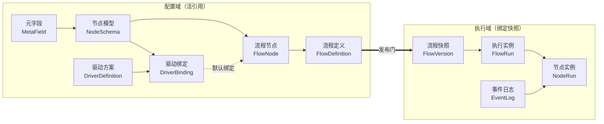

# 00 · 术语表与总览

> 文档状态：正式方案 v1.0（2026-08-09 评审定稿）
> 本文档集取代 `archive/通用节点流程视图生成器方案.md`（草案 1.0）与 `archive/design-system-v4.md`（设计规范 v4），两份旧文档仅作历史参考，不再维护。

## 1. 产品定位

FlowCanvas 是**本地优先、数据驱动、高度可自定义**的通用节点流程系统，由两个严格隔离的工作域组成：

1. **控制台**（配置域外壳）：定义元字段、节点模型、驱动方案、驱动绑定与流程编排，最终发布不可变的流程快照。
2. **执行实例**：从已发布快照创建，独立打开，维护运行字段值、节点生命周期、关注状态与事件日志。

学习计划仅作为示例数据；底层模型必须同样适用于项目交付、内容生产、审批、巡检等场景，任何行业含义只通过配置表达，不写死在内核。

### 首期非目标

- 不做执行外部动作的流程引擎（无 Webhook、无脚本执行）。
- 不做多人实时协同。
- 不自建业务服务端（云同步走用户个人云盘的应用目录）。
- 不做「独立 HTML 导出」（后期以线上分享链接替代）。

## 2. 术语表

全部文档、界面文案与代码统一使用以下术语。旧词一律废止。

| 中文术语 | 代码名 | 一句话定义 | 取代旧词 |
|---|---|---|---|
| 元字段 | `MetaField` | 可复用的字段定义（稳定键、类型、校验规则、默认值） | 元数据字段 / 原子字段 |
| 节点模型 | `NodeSchema` | 元字段的集合，代表一种节点可保存的数据结构 | 节点数据 / 字段集 |
| 驱动方案 | `DriverDefinition` | 内置的状态感知方案（时间 / 条件 / 事件），声明输入槽位与输出契约 | — |
| 驱动绑定 | `DriverBinding` | 驱动方案输入槽位与具体来源的完整映射 + 完成策略 | — |
| 流程节点 | `FlowNode` | 流程中的一个节点，引用节点模型并解析驱动模式 | — |
| 流程定义 | `FlowDefinition` | 节点与连线的编排结果（草稿态，可持续修改） | — |
| 流程快照 | `FlowVersion` | 发布产生的不可变、完全自包含的流程版本 | 发布快照 |
| 执行实例 | `FlowRun` | 从流程快照创建的一次执行，拥有独立事件日志 | — |
| 节点实例 | `NodeRun` | 执行实例中单个节点的运行投影（字段值、生命周期等） | — |
| 视图 | `View` / `ViewRenderer` | 流程数据的展示形式（布局 + 渲染 + 交互能力） | 模板 |
| 事件 | `Event` | 不可变的事实条目，事件日志的唯一内容 | — |
| 控制台 | — | 配置域的页面外壳（左深右浅撞色布局，六页导航） | 配置中心 |

> 「模板」一词整体废止并保留给未来的「流程模板」（可复用流程蓝图）概念。

## 3. 对象主干

主干链路：**元字段 → 节点模型 → 驱动绑定 → 节点编排 → 发布 → 执行**。

## 4. 两域一门

| 区域 | 引用规则 | 可变性 |
|---|---|---|
| 配置域 | **一切活引用**：修改元字段即时反映到引用它的节点模型与流程草稿（UI 给影响提示） | 随时可改 |
| 发布门 | **唯一快照点**：发布时递归固化元字段副本、节点模型副本、驱动绑定终值、子流程快照 | 生成即不可变 |
| 执行域 | 实例永远绑定创建它的流程快照，**永不迁移**；要用新版 = 开新实例 | 只追加事件日志 |

推论：**全系统唯一的版本化对象是 FlowVersion**。配置对象没有用户可见的多版本管理（无「保存新版本」、无「版本记录」页签）。

## 5. 状态引擎一页概要

- **事件 = 不可变事实**（用户操作、系统记录、外部导入），只有事实进日志；一切派生结论（条件满足、临期、超时）永不入日志。
- 生命周期与关注状态是纯函数 `recompute(流程快照, 事件日志, now)` 的计算结果，不直接存储。关闭重开后的**追算 = 重算一遍**，天然确定。
- **三权分立**：拓扑决定「轮没轮到」；驱动器决定「激活时机与关注状态」；完成权按 `completionPolicy` 配置（MVP 一律人工，`confirm` / `auto` 模式阶段三开放）。

详见 [02-状态引擎规范](02-状态引擎规范.md)。

## 6. 文档地图

| 文档 | 内容 | 依赖 |
|---|---|---|
| [00-术语表与总览](00-术语表与总览.md) | 术语、主干、边界、决策记录 | — |
| [01-领域模型与协议](01-领域模型与协议.md) | 全部对象的 TS 接口与 zod 协议、条件树、结构化槽位、校验层级 | 00 |
| [02-状态引擎规范](02-状态引擎规范.md) | 事件模型、纯函数重算、生命周期状态机、驱动器计算、追算 | 01 |
| [03-发布与快照规范](03-发布与快照规范.md) | 活引用规则、发布校验、FlowVersion 结构、递归固化、实例创建 | 01, 02 |
| [04-存储与同步规范](04-存储与同步规范.md) | 存储适配器、IndexedDB、.flowpack 信封、Google Drive 同步、冲突处理 | 01, 03 |
| [05-产品规格](05-产品规格.md) | 控制台与执行页的页面功能规格、视图协议、硬约束 | 01–04 |
| [06-实施计划](06-实施计划.md) | monorepo 结构、阶段划分、MVP 验收标准、测试策略、查证项 | 全部 |
| [07-UI设计规范](07-UI设计规范.md) | 设计原则、布局骨架、色彩排版、全局交互范式、组件规范、逐页 UI 设计 | 05 |

## 7. 关键设计决策记录

评审会（2026-08-09）逐项拍板的结论，附理由。后续推翻任何一条须在此登记变更。

1. **以 v4 主干重写统一方案**：草案 1.0 与 v4 是两套不兼容模型，v4 的「配置域/执行域分离 + 不可变快照」更严谨；草案 1.0 的校验分层、视图协议、可复现思想被吸收，其余废止。
2. **纯前端 SPA 先行**：React + TS + Vite + React Flow 封装 + zustand + IndexedDB；服务端与跨端后置。
3. **monorepo 分包**：`packages/core`（零浏览器依赖）+ `apps/web`；跨端预选 webview 壳路线（Capacitor/Tauri 后定），bridge 层与分包是两个维度，互不冲突。
4. **zod 为协议层唯一真相源**：TS 类型与运行时校验单源；元字段的用户校验规则用自定义声明式小结构（引擎解释），不用 full JSON Schema；将来对外发布 schema 走 `z.toJSONSchema()` 退路。
5. **事件溯源轻量版**：只有事实进日志，状态永远重算；追算、同步冲突合并、回放调试全部由此获益。性能不构成卡点（单人规模毫秒级），checkpoint 为预留扩展点。
6. **完成权三模式**：`manual / confirm / auto` 协议 v1 就带，MVP 仅开放 `manual`；`confirm` 的「待确认」不是新生命周期态，是重算输出的建议完成标志。
7. **system 来源结构化**：`{ ref, offset }` 受限枚举 + 表单化，不做文本表达式 DSL，消灭 parser 卡点。
8. **条件树任意组装**：`ConditionGroup{ op, children }` 递归，协议不设深度上限；比较符按数据类型矩阵约束，列表用聚合谓词。
9. **前序组语义**：`joinPolicy: all | any`（MVP 仅 all）；`previous` 解析为前序组就绪时刻（all → 最晚完成者，any → 最早满足者）。
10. **发布是唯一快照门**：配置域全活引用，FlowVersion 递归自包含（含子流程），执行实例永不迁移；配置对象去版本化。
11. **`.flowpack` = 单 JSON 信封**：浏览器零 zip 依赖，`formatVersion` 预留 zip 升级路径（附件时代）。
12. **云同步 Google Drive appDataFolder + 快照模式**：两级安全线——条件写入实测优先，未支持则读-比-写 + 应用层基线；冲突三选一（保留本地/保留远端/双副本），**永不静默覆盖**。Drive v3 条件写入官方文档未确认，列为实施前实测项。
13. **MVP 驱动器**：时间 / 条件 / 事件（应用内事件）三者都进阶段一；外部事件日志导入、confirm/auto 完成模式进阶段三。
14. **砍掉项**：独立 HTML 导出（改线上分享链接，后期）、MVP 多视图切换（视图协议保留，加视图 = 加渲染器）、配置对象多版本管理。
15. **参与语义由边推导**：连线关系（必经/可选/参考）是唯一真相，节点的参与类别为编译期推导字段，不重复存储；必经完成度不受可选节点影响。

以下为 2026-08-09 页面交互评审会追加的决策：

16. **单项目应用**：项目 = 应用本身，UI 无项目层；`.flowpack` 导入导出即工作空间边界；04 协议内部保留固定 projectId 兼容未来多项目（回填评审 #6）。
17. **控制台信息架构**：左深右浅撞色布局；左菜单六项（仪表盘/元字段/节点模型/驱动方案/流程页面/实例列表）——实例列表进配置域是对 v4「配置导航只含四页」硬约束的正式修订；首屏为仪表盘；对象关系图移出 MVP，记为未来门户页面组件，「数据流可见连线」硬约束随之顺延。
18. **执行页独立标签 + hash 路由**：URL 可复制收藏；顶栏提供「控制台」入口，不设「返回实例列表」；「配置中心」正式更名「控制台」。
19. **主题翻转为浅色唯一**：炭墨侧栏 × 暖金主色，深侧栏撞色语言全站统一；推翻 v4 Neural Noir 暗色方案；字体、圆角、禁令保留。
20. **交互范式**：混合保存（表单显式 + 画布自动）；画布会话级撤销；校验三级反馈；弹层四级分工（整页/抽屉/模态/Toast）。
21. **执行域补充**：执行证据保留简化版（`evidence.attached` 事实，文本+链接，回填评审 #8）；发布支持可选版本说明（`FlowVersion.note`）；实例永久删除仅对已归档实例开放且双确认。

以下为 2026-08-10 待决问题拍板（原《待决问题清单》13 项全部落档后清单删除；技术细节 7 项——SystemRef 自指禁令、required 覆盖优先、TimelineItem 定义、清空日志表示、链接白名单、duration 值结构、UTC 时区——按清单建议倾向直接落入 01–02，不单列）：

22. **事件匹配器**：协议全量 `{ eventTypes, nodeId? }`，MVP 校验层仅放行 `custom.recorded` 匹配；内置事实与 nodeId 过滤随阶段三外部日志导入开放（同 completionPolicy 的「协议全量、校验限阶段」模式）。
23. **空列表聚合 = false**：`all` 对空列表返回 false（刻意偏离空真惯例）；`countAtLeast.count ≥ 1` 由 zod 强制。
24. **显式空值语义**：清空（`valueSet` 且 `value: null`）= 缺值，默认值只兜底从未写过的字段；配套空值归一化表（01 §2.5），boolean 以三态控件表达「未设置」。
25. **完成度分母排除已跳过**：跳过单独计数标注；`total = 0` → `percent = 100`。
26. **子流程 nodeId 路径前缀**：`父nodeId/子nodeId`，nodeId 禁含 `/`。
27. **导入 = 替换工作空间**：确认 + 强制自动备份导出；「另存为副本」随多项目再议；冲突「双副本」在单项目下的降级方案阶段二定。
28. **工程工具链**：pnpm workspaces、vitest、ESLint（typescript-eslint）+ Prettier、GitHub Actions、TS strict、zod v4（详见 06 §1）。

以下为 2026-08-10 逐页 UI 评审（元字段页）追加的决策：

29. **组合上移到节点组装层**：MetaField 废除 `itemFields` 内嵌子字段，保持原子；object / list(object) 的内部结构改在节点模型层以子组装（`FieldBinding.itemBindings` 递归引用基础类型元字段）组合，六条边界细则见 01 §3。收益：全系统只剩一个组装心智模型，子字段复用现有元字段及其校验，活引用 / 禁删语义自然延伸到子层级。
30. **键是身份，类型是属性**：稳定键一经创建（首次保存）不可变——如数据库主键，改名走展示名，录错且未被引用删除重建，不做条件解锁；dataType 随时可改——执行域因快照隔离永不受影响，配置域草稿由影响提示 + 校验禁存禁发兜底（与修改 enum 选项同一语义）。
