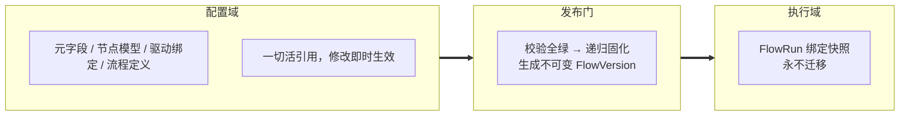

# 03 · 发布与快照规范

> 文档状态：正式方案 v1.0（2026-08-09 评审定稿）
> 依赖：[01-领域模型与协议](01-领域模型与协议.md)、[02-状态引擎规范](02-状态引擎规范.md)

## 1. 三段式模型



| 区域 | 规则 |
|---|---|
| 配置域 | 活引用：改元字段即时反映到引用它的节点模型与流程草稿；无逐层版本升级 |
| 发布门 | 唯一快照点：FlowVersion 完全自包含，与配置域彻底断开 |
| 执行域 | 实例永绑创建时的快照；配置再改不影响已有实例；要用新版 = 开新实例 |

## 2. 配置域活引用规则

1. 引用一律通过稳定键（`fieldKey` / `nodeSchemaId` / `flowId`），始终解析到最新内容。
2. **影响提示**：修改或重命名元字段时，UI 展示引用清单（哪些节点模型、哪些流程草稿在用）；修改节点模型时同理。
3. **被引用禁删**：元字段被节点模型引用、节点模型被流程引用、流程被子流程绑定引用时禁止删除，删除入口展示引用清单，解除全部引用后方可删除。
4. 已发布的 FlowVersion 内是副本，不受上述任何操作影响。

## 3. 发布流程

1. 点击「发布配置」→ 运行 [01 §8](01-领域模型与协议.md) 全部六层校验。
2. 任何错误级诊断 → 阻止发布，定位到对象；警告级 → 展示但不阻止。
3. 全绿 → 确认步骤支持填写**可选版本说明**（`note`）→ 生成 FlowVersion，版本号自增（v1、v2…），提示「配置版本 vN 已发布」，并提供「创建执行实例」次级操作。

### 3.1 发布级校验清单

- 流程入口存在且唯一（开始元节点）。
- 全部 FlowNode 的驱动解析闭合：`inherit` 时节点模型默认绑定完整；`override` 时绑定整套完整；类型兼容。
- `completionPolicy` 符合当前阶段限制（MVP 仅 `manual`）。
- 子流程引用图无循环，嵌套深度 ≤ 5。
- 无孤立节点、无必经环、必经路径可达。

## 4. 流程快照 FlowVersion

发布时把所有活引用**解析为副本**内嵌，快照自包含，执行期零引用解析：

```ts
interface FlowVersion {
  flowVersionId: string;
  flowId: string;                   // 源流程
  versionLabel: string;             // v1、v2… 自增
  note?: string;                    // 可选版本说明，发布确认时填写
  publishedAt: string;
  contentHash: string;              // 全部内容摘要，供可复现与同步比对

  metaFields: Record<string, MetaField>;        // key = fieldKey，固化副本
  nodeSchemas: Record<string, NodeSchemaSnapshot>; // 含解析后的字段绑定终值
  nodes: FlowNodeSnapshot[];        // 每个节点内嵌解析后的最终 DriverBinding（inherit 已展开）
  edges: FlowEdge[];
  subflows: Record<string, FlowVersion>;        // key = flowId，递归内嵌的子流程快照
}
```

固化要点：

- `inherit` 在发布时**展开**为最终绑定，快照内不存在 driverMode 间接层。
- 节点模型副本包含展示名、必填、默认值等覆盖的**终值**。
- 快照生成后逐字节不可变；同一草稿重复发布且内容未变时 `contentHash` 相同，可提示「与上一版无差异」。

## 5. 执行实例创建

1. 从某个 FlowVersion 点「创建执行实例」→ 生成 `FlowRun { runId, flowVersionId, name, createdAt }`。
2. 写入日志首条事实 `run.created`。
3. 开始元节点等待人工完成；完成后 `run.startedAt` 确立，后继节点按 [02 §5](02-状态引擎规范.md) 推导。
4. 同一快照可创建多个实例，互不影响。

## 6. 子流程递归固化（阶段二）

1. 发布父流程时解析 `SubflowBinding.flowId` → 将子流程**当前草稿内容**同样走全量校验并固化为内嵌 FlowVersion，递归进行。
2. 循环引用（A→B→A）与深度超限在发布校验中拒绝，诊断给出引用链。
3. 子流程修改后，须**重新发布父流程**才对新实例生效；老实例内嵌的子流程快照永不变。
4. 执行期子流程状态：子流程节点拥有独立的 NodeRun 投影（同一实例日志），下钻查看。nodeId 命名空间为**路径前缀** `父nodeId/子nodeId`——「父」即承载子流程的 FlowNode 的 nodeId，多级嵌套依次拼接（`a/b/c`）；事件日志 payload 引用子流程节点一律用完整路径；nodeId 字符集禁含 `/`（[01 §9](01-领域模型与协议.md)）。
5. **完成传播**：子流程全部必经节点完成 → 父节点出现「子流程已达成」建议完成提示，完成动作遵循父节点 completionPolicy（阶段二内即人工确认；阶段三 confirm/auto 开放后统一走完成权模型）。

## 7. 实例不迁移与归档

- 实例**永不迁移**到新 FlowVersion。想用新版：创建新实例，旧实例可归档（`run.archived` 事实，UI 默认隐藏，可恢复）。
- 未来扩展路径（未排期）：事件日志模型天然支持「将旧实例日志重放到新快照」的迁移——事实与快照解耦是本方案预留的迁移地基，实现前不做任何承诺。
