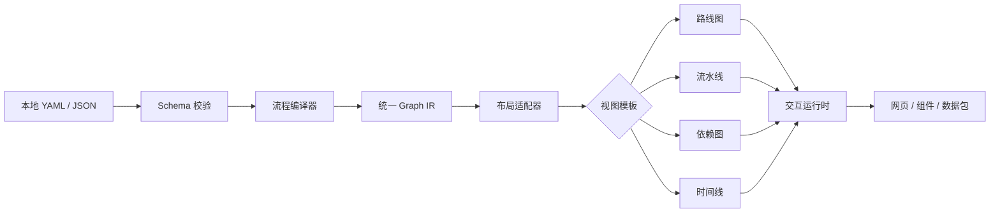
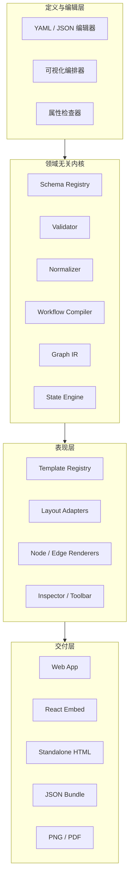
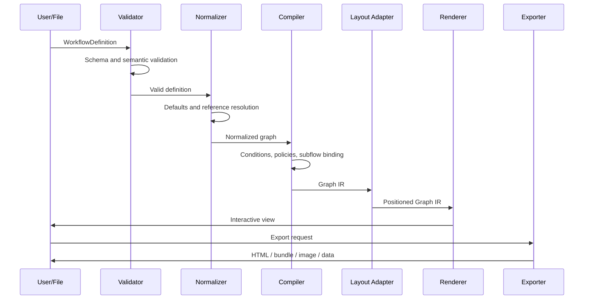
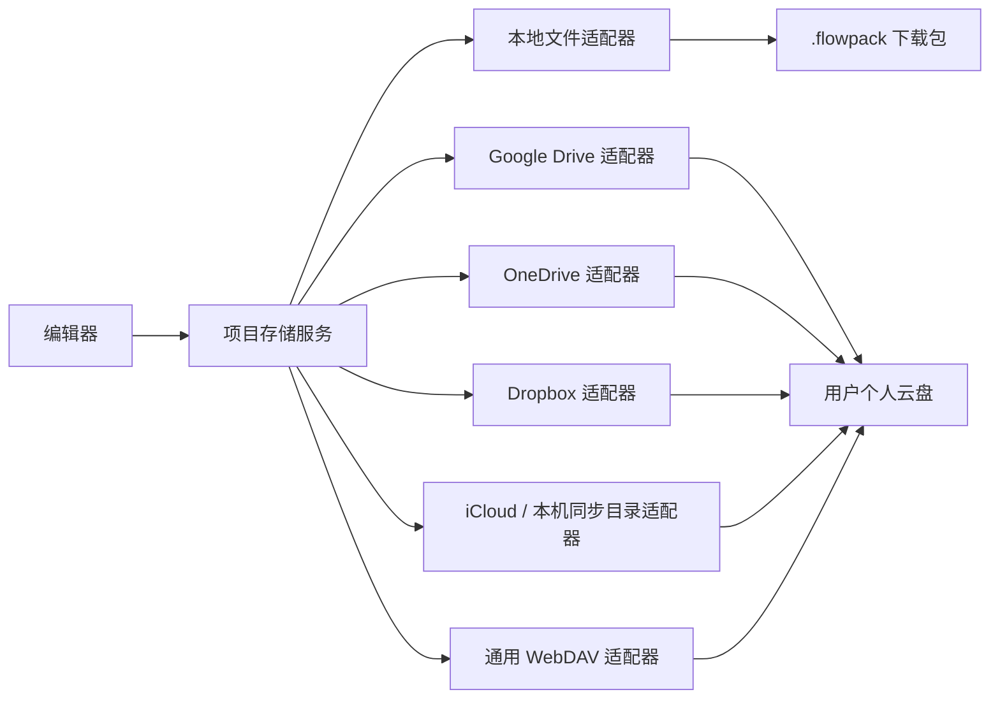

# 通用节点流程视图生成器方案

> 文档状态：方案草案 1.0
> 产品定位：本地优先、数据驱动、模板可切换的通用节点流程视图生成器
> 适用范围：流程展示、操作指引、项目路径、知识地图、依赖图、阶段图、决策路径等
> 非目标：底层模型不绑定学习计划、项目管理或某个具体行业

## 1. 方案摘要

系统允许用户在本地使用 YAML 或 JSON 定义节点、连线、子流程、状态规则和扩展属性，再通过统一编译管线生成可交互流程视图。相同的流程定义可以切换不同视图模板，并输出为独立网页、嵌入式组件或结构化数据包。

核心原则是将以下内容彻底分离：

1. **流程定义**：节点是什么、节点之间有什么关系。
2. **运行状态**：当前完成到哪里、哪些节点被阻塞或跳过。
3. **视图模板**：节点如何布局、渲染和交互。
4. **输出目标**：生成独立网页、组件、图片或数据包。



## 2. 产品目标与边界

### 2.1 产品目标

- 使用本地文件完整定义流程，无需依赖某个在线服务。
- 支持普通节点、分组、主流程、可选分支和嵌套子流程。
- 同一份数据可以切换多种流程视图模板。
- 支持自动布局，也允许保存用户手动调整后的位置。
- 支持查看、编辑、运行状态记录和成品导出。
- 提供稳定的扩展协议，允许增加节点类型、布局算法和交互面板。
- 保持领域中立，具体行业含义通过配置和扩展包表达。

### 2.2 首期非目标

- 不在第一期实现类似 BPMN 的完整流程执行引擎。
- 不允许节点配置直接执行任意本地 JavaScript 或 Shell。
- 不要求多人实时协同编辑。
- 不要求第一期支持无限层级子流程的同屏展开。
- 不把某个具体领域的状态、字段或完成规则写死在内核中。

### 2.3 三种工作模式

| 模式 | 用途 | 是否保存状态 | 是否执行外部动作 |
|---|---|---:|---:|
| 描述模式 | 展示结构、关系和路径 | 否 | 否 |
| 状态模式 | 记录完成、跳过、阻塞等状态 | 是 | 否 |
| 执行模式 | 节点触发受控操作或外部集成 | 是 | 可选，后续扩展 |

内核优先完成描述模式和状态模式；执行模式通过插件机制扩展，避免通用视图系统过早演变成自动化平台。

## 3. 总体架构



### 3.1 推荐技术组成

- UI：React + TypeScript。
- 画布交互：基于 React Flow 一类的节点画布库封装，不把其数据格式暴露为产品协议。
- Schema：JSON Schema，YAML 在加载后转换为同一对象模型。
- 自动布局：通过布局适配器接入分层布局、树形布局、时间轴布局等算法。
- 状态管理：定义数据、运行状态、视图状态分仓保存。
- 本地模式：文件加载、文件监听、导入和导出。
- 服务模式：后续增加 REST API 或数据库适配器，不改变核心 Schema。

## 4. 核心领域模型

### 4.1 WorkflowDefinition

流程定义是可以独立保存、校验、版本化和复用的最小单元。

```ts
interface WorkflowDefinition {
  schemaVersion: string;
  id: string;
  name: string;
  version: string;
  description?: string;

  mode?: "descriptive" | "stateful" | "executable";
  entryNodeIds?: string[];

  variables?: Record<string, VariableDefinition>;
  nodeTypes?: Record<string, NodeTypeExtension>;

  nodes: WorkflowNode[];
  edges: WorkflowEdge[];
  groups?: WorkflowGroup[];

  policies?: WorkflowPolicies;
  defaultView?: ViewSelection;
  metadata?: Record<string, unknown>;
}
```

### 4.2 WorkflowNode

```ts
interface WorkflowNode {
  id: string;
  type: string;
  label: string;
  description?: string;

  parentId?: string;
  groupId?: string;

  required?: boolean;
  participation?: "required" | "optional" | "reference";
  weight?: number;

  ports?: NodePort[];
  attributes?: Record<string, unknown>;
  actions?: NodeAction[];

  subflow?: SubflowBinding;
  presentation?: NodePresentationHint;
}
```

`attributes` 用于承载领域字段，但内核不理解字段的行业含义。节点类型扩展包可以为这些字段提供 Schema、表单和渲染器。

### 4.3 WorkflowEdge

```ts
type EdgeRelation =
  | "sequence"
  | "dependency"
  | "optional"
  | "reference"
  | "association"
  | "exception"
  | "subflow";

interface WorkflowEdge {
  id: string;
  source: Endpoint;
  target: Endpoint;
  relation: EdgeRelation;
  label?: string;

  behavior?: {
    blocking?: boolean;
    countsTowardCompletion?: boolean;
    traversable?: boolean;
  };

  condition?: DeclarativeCondition;
  presentation?: EdgePresentationHint;
  metadata?: Record<string, unknown>;
}

interface Endpoint {
  nodeId: string;
  portId?: string;
}
```

关系类型表达语义，线条颜色和样式由模板决定。例如 `optional` 可以在路线图模板里表现为虚线，在列表模板里表现为“可选”分区。

### 4.4 定义、运行状态与视图状态分离

```ts
interface WorkflowRuntimeState {
  workflowId: string;
  workflowVersion: string;
  instanceId: string;
  nodeStates: Record<string, NodeRuntimeState>;
  variables: Record<string, unknown>;
  updatedAt: string;
}

interface NodeRuntimeState {
  status:
    | "not_started"
    | "available"
    | "active"
    | "completed"
    | "skipped"
    | "blocked"
    | "failed";
  progress?: number;
  evidence?: EvidenceRecord[];
  startedAt?: string;
  completedAt?: string;
}

interface WorkflowViewState {
  templateId: string;
  viewport?: { x: number; y: number; zoom: number };
  nodePositions?: Record<string, { x: number; y: number }>;
  collapsedNodeIds?: string[];
  selectedNodeId?: string;
}
```

这种分离可以保证：修改节点位置不会污染流程定义，切换模板不会改变运行进度，更新流程版本时也可以单独迁移状态。

## 5. 子流程设计

节点必须从第一版 Schema 就支持子流程，但首版 UI 可以先限制为一层展开。

### 5.1 两种子流程来源

#### 内嵌子流程

适合规模小、不会复用的流程片段。

```yaml
subflow:
  source: inline
  workflow:
    id: embedded-flow
    name: Embedded flow
    version: 1.0.0
    nodes: []
    edges: []
```

#### 引用子流程

适合可复用、独立维护或内容较大的流程。

```yaml
subflow:
  source: reference
  workflowRef: ./flows/reusable-process.yaml
  versionPolicy: exact
  inputs:
    itemId: ${context.itemId}
  outputs:
    result: ${subflow.result}
```

### 5.2 子流程绑定模型

```ts
interface SubflowBinding {
  source: "inline" | "reference";
  workflow?: WorkflowDefinition;
  workflowRef?: string;
  versionPolicy?: "exact" | "compatible" | "latest";

  displayMode?: "inline" | "drilldown" | "drawer";
  completionPolicy?:
    | "all_required"
    | "any_terminal"
    | "manual"
    | "percentage";
  completionThreshold?: number;

  inputs?: Record<string, string>;
  outputs?: Record<string, string>;
}
```

### 5.3 子流程行为规则

- 子流程定义拥有独立 ID 和版本。
- 父节点是否完成由 `completionPolicy` 决定。
- 子流程内部的可选节点默认不阻塞父节点完成。
- 引用链必须做循环检测和最大深度限制。
- 删除父节点时只删除绑定关系，不删除外部引用文件。
- 模板不支持内联展开时，应自动降级为下钻或抽屉模式。
- 子流程输入输出只允许使用声明式映射，不执行任意代码。

## 6. 非主流程接入设计

非主流程内容可能是可选分支、参考信息、辅助步骤、异常路径或关联节点。它们不能统一视为普通的“下一步”。

### 6.1 关系与参与策略

关系描述“两个节点为什么连接”；参与策略描述“节点如何影响流程完成”。两者必须分开。

| 关系 | 默认阻塞 | 默认计入完成度 | 典型展示 |
|---|---:|---:|---|
| `sequence` | 是 | 是 | 主线实线 |
| `dependency` | 是 | 是 | 依赖箭头 |
| `optional` | 否 | 否 | 侧挂虚线 |
| `reference` | 否 | 否 | 弱化关联 |
| `association` | 否 | 否 | 无方向关联 |
| `exception` | 条件触发后是 | 可配置 | 异常分支 |
| `subflow` | 按父节点策略 | 按父节点策略 | 展开或下钻入口 |

单条边可以覆盖默认行为：

```yaml
behavior:
  blocking: false
  countsTowardCompletion: true
  traversable: true
```

### 6.2 什么时候建成节点

- 内容有独立状态、负责人、动作或统计需求：建成节点。
- 内容需要参与依赖、分支或子流程：建成节点。
- 只是一个链接、文件或简短说明：作为节点附件。
- 只用于解释当前节点：放入详情面板，不进入图结构。

### 6.3 可选节点的完成度

运行时同时提供至少两组指标：

```ts
interface CompletionSummary {
  required: {
    completed: number;
    total: number;
    percent: number;
  };
  optional: {
    completed: number;
    total: number;
    percent: number;
  };
}
```

必达完成度不得因可选节点未完成而降低。模板可以选择同时展示“主线完成度”和“扩展完成度”。

## 7. 模板系统

### 7.1 模板职责

模板负责：

- 布局方式。
- 节点和连线渲染。
- 主题、颜色和字体。
- 详情面板、工具栏和图例。
- 子流程如何展开。
- 哪些交互能力可用。

模板不负责：

- 改写节点关系语义。
- 改写 required/optional 参与策略。
- 保存领域运行状态。
- 执行节点动作。

### 7.2 模板清单

```ts
interface ViewTemplateManifest {
  id: string;
  name: string;
  version: string;
  description?: string;

  layoutAdapter: string;
  nodeRenderers: Record<string, string>;
  edgeRenderers: Partial<Record<EdgeRelation, string>>;

  inspector?: string;
  toolbar?: string;
  minimap?: string;
  theme: string;

  capabilities: {
    nestedSubflow: "inline" | "drilldown" | "drawer" | "unsupported";
    manualPositioning: boolean;
    grouping: boolean;
    conditionalEdges: boolean;
  };
}
```

### 7.3 建议内置模板

| 模板 | 布局 | 适用结构 |
|---|---|---|
| `roadmap` | 阶段化路径 | 路线、成长路径、实施路径 |
| `pipeline` | 左到右分层 | 顺序流程、处理管线 |
| `dependency` | 有向依赖图 | 模块依赖、任务前置关系 |
| `timeline` | 时间轴 | 里程碑、发布节奏、阶段安排 |
| `tree` | 树形 | 分解结构、目录、决策树 |
| `freeform` | 自由画布 | 手工编排、混合关系 |

### 7.4 模板兼容与降级

编译器在渲染前检查模板能力：

- 不支持内联子流程：降级为下钻入口。
- 不支持分组：将组信息转换为标签或背景区块。
- 不支持某种边：使用通用边渲染器，但保留关系语义。
- 不支持手动定位：忽略当前模板的位置数据，不删除原数据。
- 存在无法安全降级的能力：输出明确错误，不静默丢失内容。

## 8. 编译和渲染管线



### 8.1 Graph IR

内部统一中间结构隔离外部 Schema、画布库和布局算法：

```ts
interface GraphIR {
  workflow: {
    id: string;
    version: string;
  };
  nodes: CompiledNode[];
  edges: CompiledEdge[];
  groups: CompiledGroup[];
  warnings: CompileDiagnostic[];
  capabilities: GraphCapabilities;
}
```

画布库的数据结构只能出现在渲染适配器内部，防止未来更换库时污染用户文件。

### 8.2 校验层级

1. **语法校验**：JSON/YAML 是否能解析。
2. **Schema 校验**：字段类型和必填项。
3. **引用校验**：节点、端口、组、子流程文件是否存在。
4. **图语义校验**：重复 ID、非法自环、不可达节点、依赖环。
5. **策略校验**：完成策略和参与策略是否冲突。
6. **模板兼容校验**：选定模板是否能表达当前结构。

诊断信息必须带文件、路径、节点 ID 和修复建议。

## 9. 通用配置示例

下面示例仅展示协议能力，不代表任何特定业务。

```yaml
schemaVersion: 1.0.0
id: generic-process
name: Generic Process
version: 1.0.0
mode: stateful

entryNodeIds:
  - start

nodes:
  - id: start
    type: milestone
    label: Start
    participation: required

  - id: primary-step
    type: task
    label: Primary step
    participation: required
    subflow:
      source: reference
      workflowRef: ./flows/reusable-process.yaml
      versionPolicy: exact
      displayMode: drilldown
      completionPolicy: all_required

  - id: optional-step
    type: task
    label: Optional step
    participation: optional

  - id: reference-item
    type: resource
    label: Reference item
    participation: reference

  - id: end
    type: milestone
    label: End
    participation: required

edges:
  - id: start-to-primary
    source: { nodeId: start }
    target: { nodeId: primary-step }
    relation: sequence

  - id: primary-to-end
    source: { nodeId: primary-step }
    target: { nodeId: end }
    relation: sequence

  - id: primary-to-optional
    source: { nodeId: primary-step }
    target: { nodeId: optional-step }
    relation: optional

  - id: primary-to-reference
    source: { nodeId: primary-step }
    target: { nodeId: reference-item }
    relation: reference

policies:
  completion:
    requiredNodesOnly: true
  subflows:
    maxDepth: 5
    circularReferences: reject

defaultView:
  templateId: roadmap
  variant: dark
```

## 10. 编辑器设计

### 10.1 页面结构

```text
┌──────────────────────────────────────────────────────────────┐
│ 文件 / 模板 / 校验 / 预览 / 导出                            │
├──────────────┬────────────────────────────┬──────────────────┤
│ 节点与流程库 │                            │ 属性检查器       │
│              │       节点流程画布         │                  │
│ 模板列表     │                            │ 节点 / 边 / 流程 │
│ 大纲树       │                            │ 子流程 / 状态规则│
├──────────────┴────────────────────────────┴──────────────────┤
│ 校验结果 / 编译警告 / 当前文件 / 保存状态                   │
└──────────────────────────────────────────────────────────────┘
```

### 10.2 编辑方式

- 文件优先：直接修改 YAML/JSON，画布实时刷新。
- 画布优先：拖拽、连线和属性表单编辑，保存回配置文件。
- 混合模式：画布和源码双向同步，冲突时明确提示。

### 10.3 核心操作

- 创建、复制、删除和分组节点。
- 创建带关系类型的连线。
- 将选中节点封装成子流程。
- 引用已有子流程。
- 将节点标记为必达、可选或参考。
- 切换视图模板但保持选中节点和运行状态。
- 自动布局后手动微调，并保存模板专属位置。
- 查看不可达节点、循环依赖和模板兼容警告。

## 11. 本地项目结构

```text
workflow-project/
├── workflow.yaml
├── workflow.state.json
├── flows/
│   ├── reusable-process.yaml
│   └── another-process.yaml
├── node-types/
│   └── custom-node.schema.json
├── templates/
│   └── custom-template/
│       ├── template.json
│       ├── theme.json
│       └── assets/
├── attachments/
└── exports/
```

默认只把 `workflow.yaml` 和被引用的流程文件视为流程真相源。运行状态、视图位置和导出结果分别保存，避免互相覆盖。

## 12. 本地下载与个人云同步

本地下载是基础能力，个人云同步是可选存储适配器。两者都不改变流程定义、编译器和模板协议，也不要求平台自建业务服务端。



### 12.1 下载类型

用户可以分别下载：

| 类型 | 包含内容 | 典型用途 |
|---|---|---|
| 配置包 | 流程定义、子流程、模板选择、节点类型声明 | 复用和分享流程结构 |
| 数据包 | 运行状态、变量、证据、用户数据 | 备份或迁移进度 |
| 完整项目包 | 配置、数据、附件、视图状态、版本锁 | 完整备份与跨设备迁移 |
| 成品包 | 编译后的 HTML、JS、CSS 和静态资源 | 离线展示和发布 |

完整项目使用 `.flowpack` 扩展名，本质上是可检查的 ZIP 包：

```text
example.flowpack
├── manifest.json
├── workflow.yaml
├── flows/
├── runtime/
│   └── default.state.json
├── views/
│   └── roadmap.view.json
├── node-types/
├── attachments/
└── workflow.lock.json
```

`manifest.json` 至少包含：

- 包格式版本。
- 项目 ID 和流程版本。
- 文件清单、大小和内容摘要。
- 创建时间和最近修改时间。
- 默认入口流程和默认模板。
- 是否包含运行数据和附件。

令牌、OAuth 凭证、本机绝对路径和其他设备秘密不得写入下载包。

### 12.2 本地文件能力

提供两种兼容模式：

1. 浏览器支持目录或文件句柄时，用户主动选择项目目录，应用在授权范围内读写。
2. 不支持直接文件访问时，使用“导入文件”和“下载文件”完成显式保存。

本地自动保存只能写入用户已经授权的句柄或应用自己的浏览器存储，不能静默扫描本机目录。

### 12.3 云存储统一接口

```ts
interface CloudStorageProvider {
  readonly id: string;
  readonly capabilities: CloudProviderCapabilities;

  connect(options?: ConnectOptions): Promise<CloudAccount>;
  disconnect(): Promise<void>;
  getConnectionState(): Promise<CloudConnectionState>;

  list(path: string): Promise<CloudEntry[]>;
  stat(path: string): Promise<CloudEntry | null>;
  download(path: string): Promise<Blob>;
  upload(
    path: string,
    content: Blob,
    options?: UploadOptions
  ): Promise<CloudEntry>;
  remove(path: string, revision?: string): Promise<void>;
}

interface UploadOptions {
  expectedRevision?: string;
  contentHash?: string;
  createOnly?: boolean;
}

interface CloudProviderCapabilities {
  appFolder: boolean;
  visibleFiles: boolean;
  revisions: boolean;
  conditionalWrite: boolean;
  changeFeed: boolean;
  backgroundSync: boolean;
}
```

内核只调用这个接口；OAuth、路径格式、版本标识、分片上传和平台错误码都由各适配器处理。

### 12.4 平台接入策略

| 平台 | 推荐保存位置 | 适合首期 | 关键说明 |
|---|---|---:|---|
| Google Drive | `appDataFolder` 或用户选择的可见目录 | 是，优先 | 隐藏应用目录适合配置和状态；可见文件应使用用户授权的文件范围 |
| OneDrive | `Apps/{应用名}` 应用目录 | 是 | Microsoft Graph 提供 `approot` 和最小权限范围 |
| Dropbox | App Folder | 是 | 默认只访问应用目录，不申请整个 Dropbox 权限 |
| iCloud Drive | 用户选择的本机 iCloud Drive 目录或原生文档容器 | 条件支持 | 纯 Web 接入方式与前三者不同，需区分 iCloud Drive 和 CloudKit |
| WebDAV | 用户提供服务地址和授权 | 第二阶段 | 可覆盖更多自建云盘和 NAS，但兼容性需要验证 |

#### Google Drive

提供两种模式：

- **隐式应用数据**：使用 `appDataFolder` 保存配置、状态和同步元数据。内容不会出现在普通 Drive 界面中，也不能直接分享。
- **用户可见项目**：让用户选择或创建可见目录，保存 `.flowpack` 或项目文件。权限只申请应用创建或用户明确选择的文件范围。

首版建议默认使用 `appDataFolder` 做自动同步，同时保留“另存到 Google Drive”将项目包保存为用户可见文件。

#### OneDrive

使用 Microsoft Graph 的应用目录，目录位于用户 OneDrive 的 `Apps/{应用名}` 下。应用通过 `Files.ReadWrite.AppFolder` 一类的最小权限访问，不需要读取整个 OneDrive。

#### Dropbox

创建 Dropbox 应用时选择 App Folder 访问级别，仅同步 `/Apps/{应用名}` 下的数据。只有用户明确要求访问已有任意文件时，才考虑更广的 Full Dropbox 权限。

#### iCloud

iCloud 需要区分两种产品形态：

- **iCloud Drive 文件**：更适合 macOS/iOS 原生应用、桌面封装应用或由用户选择本机已同步的 iCloud Drive 目录。
- **CloudKit 应用数据**：Web 可以使用 CloudKit JS 访问应用自己的 CloudKit 容器，但它不是任意 iCloud Drive 文件的通用替代接口，并且需要配置 Apple 应用和 CloudKit 容器。

因此纯 Web 首版不承诺与 Google Drive 相同形式的 iCloud Drive 直连。可以先支持“打开/保存到本机 iCloud Drive 同步目录”，后续有原生客户端时再实现 iCloud 文档容器。

### 12.5 不使用自建服务端时的认证边界

Google Drive、OneDrive 和 Dropbox 可以由前端通过各平台允许的浏览器授权流程直接连接，但仍需分别注册开发者应用并配置 OAuth 回调地址。

- 只申请完成同步所需的最小权限。
- 浏览器端不包含平台客户端密钥。
- 凭证不得进入流程文件、下载包、日志或模板数据。
- Web 端凭证只保存在受控的本地凭证存储中；桌面端优先使用操作系统钥匙串。
- 授权过期时进入 `auth_expired` 状态，由用户重新连接。
- 纯 Web 页面关闭后不能保证继续后台同步；真正的无人值守同步需要原生常驻进程或自建服务端。

### 12.6 同步单位

系统支持两种同步模式：

#### 快照模式

每次上传一个 `.flowpack` 文件。

- 优点：原子性好、实现简单、容易备份和恢复。
- 缺点：附件变更也可能导致整个包重新上传，不适合超大项目。

#### 目录模式

分别同步流程、状态、视图和附件文件。

- 优点：增量小、文件可单独查看和合并。
- 缺点：需要处理多文件一致性和部分上传失败。

MVP 先实现快照模式；目录模式在同步协议稳定后增加。

### 12.7 同步状态与触发方式

```ts
type SyncStatus =
  | "disconnected"
  | "idle"
  | "dirty"
  | "syncing"
  | "synced"
  | "offline"
  | "conflict"
  | "auth_expired"
  | "error";
```

支持以下触发方式：

- 手动“上传到云端”和“从云端恢复”。
- 本地保存后延迟自动同步。
- 页面重新打开时检查远端版本。
- 网络恢复后提示继续同步。
- 云平台提供变更能力时，在页面存活期间检查远端更新。

默认先写入本地，再异步同步云端。云端失败不得导致用户本地修改丢失。

### 12.8 冲突检测与处理

每次同步保存以下基线：

```ts
interface SyncBaseline {
  providerId: string;
  remotePath: string;
  remoteRevision?: string;
  localContentHash: string;
  remoteContentHash?: string;
  syncedAt: string;
}
```

上传时使用平台版本号、ETag 或内容摘要做条件写入。若本地和远端都相对基线发生变化，必须进入冲突状态，禁止静默覆盖。

冲突界面提供：

- 保留本地并另存一个远端版本。
- 使用远端并备份本地版本。
- 同时保留两个项目副本。
- 对可安全合并的结构化文件展示字段级差异，再由用户确认合并。

系统不得超时自动选择冲突解决方案。

### 12.9 同步隐私与加密

- 默认同步包不包含 OAuth 凭证和设备私有信息。
- 用户可以选择不上传附件、证据或运行状态。
- 对敏感项目可增加客户端加密的 `.flowpack`；云平台只保存密文。
- 加密密钥由用户管理，不与密文存放在同一云目录。
- 分享链接与个人同步使用不同权限和不同操作入口。

### 12.10 推荐实施顺序

1. 本地配置包、数据包和完整 `.flowpack` 下载/导入。
2. `CloudStorageProvider` 接口、同步状态机和冲突保护。
3. Google Drive `appDataFolder` 自动同步及用户可见文件另存。
4. OneDrive App Folder。
5. Dropbox App Folder。
6. 本机同步目录，覆盖 iCloud Drive、OneDrive 和 Dropbox 桌面客户端目录。
7. WebDAV 和原生 iCloud/CloudKit 适配器。

### 12.11 官方能力依据

- [Google Drive 文件空间与 appDataFolder](https://developers.google.com/workspace/drive/api/guides/about-files)
- [Google Drive 应用专属数据目录](https://developers.google.com/workspace/drive/api/guides/appdata)
- [Google Drive OAuth 权限范围](https://developers.google.com/workspace/drive/api/guides/api-specific-auth)
- [Microsoft Graph OneDrive App Folder](https://learn.microsoft.com/en-us/graph/onedrive-sharepoint-appfolder)
- [Dropbox OAuth 与 App Folder 权限](https://developers.dropbox.com/oauth-guide)
- [Apple iCloud 数据与文档存储方式](https://developer.apple.com/documentation/technologyoverviews/shared-data)
- [CloudKit JS](https://developer.apple.com/documentation/CloudKitJS)

## 13. 导出和成品形态

### 13.1 支持的输出

- 独立 HTML：无需开发环境即可打开。
- 静态站点目录：包含 HTML、JS、CSS 和资源文件。
- React 嵌入组件：用于集成已有系统。
- 数据包：规范化定义、运行状态、模板引用和资源清单。
- 图片/PDF：用于汇报和归档，不保留交互能力。

### 13.2 可复现导出

导出包需要写入：

- 流程 Schema 版本。
- 流程定义版本与内容摘要。
- 模板 ID 和精确版本。
- 编译器版本。
- 外部子流程和资源清单。
- 构建时间及校验结果。

这样同一输入能够在未来复现相同成品，也便于定位模板升级导致的视觉变化。

## 14. 扩展机制

### 14.1 扩展点

- 节点类型扩展。
- 属性表单扩展。
- 节点和连线渲染器。
- 布局适配器。
- 详情面板和工具栏。
- 数据导入器和导出器。
- 受控节点动作。

### 14.2 扩展包约束

- 每个扩展包必须声明 ID、版本、兼容的内核版本和能力。
- 自定义字段必须附带 JSON Schema。
- 模板必须声明不支持能力的降级方式。
- 浏览器中运行的扩展不得默认访问文件系统和网络。
- 条件表达式使用受限 DSL 或 JSON Logic 一类的声明式结构，禁止直接 `eval`。

## 15. 版本与迁移

系统同时管理四类版本：

| 版本 | 作用 |
|---|---|
| `schemaVersion` | 配置文件协议版本 |
| `workflow.version` | 用户流程定义版本 |
| `template.version` | 视图模板版本 |
| `runtime/compiler version` | 编译和运行规则版本 |

流程升级时通过显式迁移完成：

```ts
interface WorkflowMigration {
  fromVersion: string;
  toVersion: string;
  migrateDefinition(input: unknown): unknown;
  migrateRuntimeState?(input: unknown): unknown;
}
```

不得在用户不知情的情况下覆盖原始文件；迁移前生成备份或新文件。

## 16. 安全与稳定性

- 所有输入先经过 Schema 和语义校验。
- 富文本、链接和附件路径必须净化与限制协议。
- 引用文件只允许访问项目根目录内或显式授权目录。
- 子流程解析限制深度、节点总数和引用次数。
- 条件表达式不得执行任意代码。
- 外部动作默认关闭，并通过白名单、权限提示和审计日志启用。
- 导出时复制或指纹化资源，避免路径失效和资源替换。
- 大图采用按视口渲染、分组折叠和渐进布局。

## 17. 分阶段实施计划

### 阶段一：通用内核与单模板闭环

- 定义 Workflow、Node、Edge、RuntimeState 和 ViewState Schema。
- 实现 YAML/JSON 加载、校验、规范化和 Graph IR。
- 支持 `sequence`、`dependency`、`optional`、`reference`。
- 实现一层引用子流程和下钻查看。
- 实现 `roadmap` 模板、节点详情和基础状态操作。
- 支持保存视图状态和导出独立 HTML。
- 支持配置包、数据包和完整 `.flowpack` 的下载与导入。

### 阶段二：证明多模板与复杂结构

- 增加 `pipeline` 和 `dependency` 模板。
- 接入多种布局适配器。
- 支持分组、折叠、端口和条件边。
- 支持模板能力检查与降级。
- 支持主线和可选完成度分别统计。
- 加入可视化编辑和保存回文件。
- 实现云存储统一接口、同步状态机和冲突保护。
- 优先接入 Google Drive，再接入 OneDrive 和 Dropbox。

### 阶段三：产品化与扩展生态

- 模板和节点类型扩展包。
- 流程版本迁移与状态迁移。
- React 嵌入组件和完整导出工具。
- 大图性能优化、搜索、过滤和导航。
- 可选的后端存储、分享和协作能力。
- 受控动作与外部系统集成。

## 18. MVP 验收标准

1. 同一份流程定义无需改数据即可在至少三种模板间切换。
2. 主流程、可选分支和参考节点在所有模板中语义保持一致。
3. 可选节点未完成时，必达完成度不受影响。
4. 普通节点可以引用一个独立子流程并下钻查看。
5. 子流程必达节点完成后，父节点按配置自动完成。
6. 循环引用、重复 ID、缺失节点和非法关系能得到精确诊断。
7. 模板不支持某能力时有明确降级或阻止渲染，不能静默丢失。
8. 节点位置、选中状态和缩放不写入流程定义主体。
9. 可从本地 YAML/JSON 生成无需开发服务器的独立网页。
10. 对同一输入和锁定版本，重复导出结果保持可复现。
11. 配置、数据和完整项目可以分别下载，并能从 `.flowpack` 恢复。
12. 本地和远端同时修改时进入冲突状态，不得静默覆盖任意一方。
13. 切换云平台只替换存储适配器，不修改 Workflow Schema。

## 19. 测试策略

| 测试层 | 重点 |
|---|---|
| Schema 测试 | 字段、默认值、兼容性和错误路径 |
| 图语义测试 | 环、不可达节点、端口、分支和引用 |
| 子流程测试 | 完成传播、输入输出、循环和深度限制 |
| 状态测试 | 必达与可选完成度、跳过、阻塞和迁移 |
| 模板契约测试 | 能力声明、降级、节点/边语义一致性 |
| 视觉回归 | 不同规模和状态下的模板截图 |
| 导出测试 | 离线打开、资源完整性和版本锁定 |
| 同步契约测试 | 上传、下载、版本冲突、离线和授权过期 |
| 性能测试 | 大节点量、频繁状态更新和模板切换 |

## 20. 关键设计决策

1. **流程定义不直接采用画布库格式**：避免锁定某个渲染实现。
2. **父子归属和流程关系分开**：`parentId` 表达结构，`edge` 表达语义。
3. **可选性属于参与策略**：不能只靠虚线或颜色表达。
4. **子流程是独立流程绑定**：支持版本、输入输出和复用，而不是简单节点数组。
5. **模板是表现适配器**：允许布局差异，但不能修改流程含义。
6. **运行状态独立存储**：流程定义可以复用到多个运行实例。
7. **先做状态型视图，再扩展执行能力**：控制内核复杂度和安全风险。
8. **云同步使用适配器而不是内核能力**：支持个人云盘但不绑定单一厂商。
9. **本地先落盘、云端后同步**：网络或授权失败不能造成用户修改丢失。

## 21. 建议的首个验证样例

首个验证不应该只使用一个具体领域的数据。建议准备三份小型夹具：

- 线性流程：验证主线、里程碑和进度。
- 分支流程：验证可选、异常和参考关系。
- 嵌套流程：验证子流程引用、完成传播和模板降级。

然后使用相同内核分别渲染成路线图、流水线和依赖图。三类数据、三种模板全部通过后，再把实际应用场景作为示例模板接入，能够更可靠地证明系统没有被某个领域绑死。
