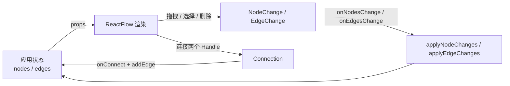

# React Flow 学习指南

> 文档基线：React Flow 12，包名 `@xyflow/react`；编写时官方最新版本为 `12.11.3`（2026-08-24 核对）。
> 适用读者：熟悉 React、TypeScript、组件状态和事件回调，希望实现流程图、工作流编辑器或节点式 UI 的前端开发者。

## 1. React Flow 是什么

React Flow 是一个用于构建**节点式界面**的 React 组件库。它负责画布层的通用能力：

- 渲染节点和连线；
- 节点拖拽、框选、缩放和平移；
- 从端口拖出连线；
- 自定义节点、连线和工具组件；
- 暴露画布坐标、视口和图关系查询 API。

它不是业务流程引擎，也不会替你定义审批规则、节点状态、发布版本或持久化协议。可以把它理解为：

> React Flow 管“图怎么展示和编辑”，业务代码管“这张图代表什么、是否合法、如何保存和运行”。

## 2. 三个核心对象

### 2.1 Node：节点

最小节点需要 `id`、`position` 和 `data`：

```ts
import type { Node } from '@xyflow/react';

type TaskData = {
  label: string;
  status: 'pending' | 'running' | 'done';
};

type TaskNode = Node<TaskData, 'task'>;

const node: TaskNode = {
  id: 'task-1',
  type: 'task',
  position: { x: 120, y: 80 },
  data: { label: '需求评审', status: 'pending' },
};
```

- `id` 是图内唯一标识，也是连线引用节点的外键。
- `position` 是节点在画布坐标系中的位置，不是浏览器页面坐标。
- `data` 是交给自定义 React 节点组件的业务数据。
- `type` 用来从 `nodeTypes` 中选择渲染组件。

### 2.2 Edge：连线

最小连线需要 `id`、`source` 和 `target`：

```ts
import type { Edge } from '@xyflow/react';

type DependencyEdge = Edge<
  { relation: 'sequence' | 'optional' },
  'smoothstep'
>;

const edge: DependencyEdge = {
  id: 'task-1->task-2',
  source: 'task-1',
  target: 'task-2',
  type: 'smoothstep',
  data: { relation: 'sequence' },
};
```

节点有多个端口时，再设置 `sourceHandle` 和 `targetHandle`，否则 React Flow 无法判断连到哪一个端口。

### 2.3 Viewport：视口

```ts
type Viewport = {
  x: number;
  y: number;
  zoom: number;
};
```

视口描述“画布内容如何映射到当前可见区域”。节点位置没有因为用户缩放而改变，改变的是 `viewport`。

## 3. 安装与最小运行条件

```bash
pnpm add @xyflow/react@^12.11.3
```

全局样式入口中引入样式：

```css
@import '@xyflow/react/dist/style.css';
```

最小示例：

```tsx
import { useCallback } from 'react';
import {
  addEdge,
  Background,
  Controls,
  ReactFlow,
  useEdgesState,
  useNodesState,
  type Connection,
  type Edge,
  type Node,
} from '@xyflow/react';

const initialNodes: Node[] = [
  { id: 'a', position: { x: 0, y: 0 }, data: { label: '开始' } },
  { id: 'b', position: { x: 240, y: 120 }, data: { label: '完成' } },
];

const initialEdges: Edge[] = [
  { id: 'a-b', source: 'a', target: 'b' },
];

export function BasicFlow() {
  const [nodes, , onNodesChange] = useNodesState(initialNodes);
  const [edges, setEdges, onEdgesChange] = useEdgesState(initialEdges);

  const onConnect = useCallback(
    (connection: Connection) => {
      setEdges((currentEdges) => addEdge(connection, currentEdges));
    },
    [setEdges],
  );

  return (
    <div style={{ width: '100%', height: 600 }}>
      <ReactFlow
        nodes={nodes}
        edges={edges}
        onNodesChange={onNodesChange}
        onEdgesChange={onEdgesChange}
        onConnect={onConnect}
        fitView
      >
        <Background />
        <Controls />
      </ReactFlow>
    </div>
  );
}
```

最常见的两个空白画布原因：

1. 忘记引入 `@xyflow/react/dist/style.css`；
2. `<ReactFlow />` 的父容器没有可计算的宽高。

## 4. 最重要的心智模型：受控数据流

生产项目通常使用受控模式：`nodes` 和 `edges` 由应用持有，React Flow 把用户操作转换成 change 事件，应用再决定如何更新状态。



`useNodesState` 和 `useEdgesState` 只是把上面的样板逻辑封装好了：

```ts
const [nodes, setNodes, onNodesChange] = useNodesState(initialNodes);
const [edges, setEdges, onEdgesChange] = useEdgesState(initialEdges);
```

更复杂的编辑器可以改用 Zustand、Redux 或项目自己的 store，但事件闭环不变。

### 不可变更新

React Flow 12 要求更新节点或连线时创建新对象，不要原地修改：

```ts
setNodes((nodes) =>
  nodes.map((node) =>
    node.id === nodeId
      ? { ...node, data: { ...node.data, label: nextLabel } }
      : node,
  ),
);
```

## 5. 自定义节点

自定义节点就是普通 React 组件，再通过 `nodeTypes` 注册。

```tsx
import { memo } from 'react';
import {
  Handle,
  Position,
  type Node,
  type NodeProps,
} from '@xyflow/react';

type TaskNode = Node<
  { label: string; status: 'pending' | 'done' },
  'task'
>;

const TaskNodeView = memo(function TaskNodeView({
  data,
  selected,
}: NodeProps<TaskNode>) {
  return (
    <article className={selected ? 'task-node is-selected' : 'task-node'}>
      <Handle type="target" position={Position.Left} />
      <strong>{data.label}</strong>
      <span>{data.status}</span>
      <Handle type="source" position={Position.Right} />
    </article>
  );
});

const nodeTypes = { task: TaskNodeView };
```

```tsx
<ReactFlow nodeTypes={nodeTypes} nodes={nodes} edges={edges} />
```

`nodeTypes` 应定义在组件外，或使用 `useMemo` 保持引用稳定。自定义节点也建议用 `memo`。

### 节点内交互元素

- 给不应触发节点拖拽的表单控件添加 `nodrag` 类名；
- 给不应触发画布平移的区域添加 `nopan`；
- 给不应触发滚轮缩放或画布滚动的区域添加 `nowheel`。

```tsx
<input className="nodrag nowheel" value={value} onChange={onChange} />
```

### 动态端口

如果端口数量或位置在运行时发生变化，应在 DOM 更新后调用 `useUpdateNodeInternals(nodeId)`，让 React Flow 重新测量 Handle。

## 6. 连线与校验

一次拖线成功后，`onConnect` 收到的是 `Connection`，它不是完整的 `Edge`。通常用 `addEdge` 补齐并去重：

```ts
const onConnect = useCallback(
  (connection: Connection) => {
    setEdges((edges) =>
      addEdge({ ...connection, type: 'smoothstep' }, edges),
    );
  },
  [setEdges],
);
```

全局业务校验放在 `<ReactFlow isValidConnection={...} />`：

```ts
const isValidConnection = useCallback(
  (connection: Connection) => connection.source !== connection.target,
  [],
);
```

实际工作流还应校验：

- 端口方向与数据类型是否兼容；
- 是否允许重复连线；
- 是否超过入度或出度限制；
- 是否形成环；
- 业务关系类型是否允许连接这两个节点。

## 7. 视口和坐标

`useReactFlow()` 返回实例，可操作视口或转换坐标：

```tsx
const { fitView, screenToFlowPosition, setCenter } = useReactFlow();

await fitView({ padding: 0.2, duration: 300 });

const flowPosition = screenToFlowPosition({
  x: event.clientX,
  y: event.clientY,
});

await setCenter(flowPosition.x, flowPosition.y, { zoom: 1.2 });
```

拖拽侧栏条目到画布时，必须把屏幕坐标转换为画布坐标，再写入新节点的 `position`。

## 8. Provider 与 Hooks 的边界

以下两种位置可以直接调用 React Flow Hooks：

1. `<ReactFlow>` 的子组件；
2. `<ReactFlowProvider>` 包裹范围内的组件。

错误示例：在渲染 `<ReactFlow>` 的同一个父组件顶层直接调用 `useReactFlow()`，但外层没有 Provider。

```tsx
export function FlowPage() {
  return (
    <ReactFlowProvider>
      <FlowEditor />
    </ReactFlowProvider>
  );
}
```

如果工具栏、属性面板和画布是兄弟组件，推荐把三者都放进同一个 `ReactFlowProvider`。

## 9. 保存什么，不保存什么

原型可以直接保存 `instance.toObject()`，它包含 `nodes`、`edges`、`viewport`。业务系统不应不加筛选地把 React Flow 对象当领域协议。

建议分层：

| 数据 | 建议归属 | 是否持久化 |
|---|---|---|
| 节点业务字段、关系语义 | 领域模型 | 是 |
| 节点 x/y、折叠状态 | 视图配置 | 通常是 |
| 视口 x/y/zoom | 用户视图状态 | 按需 |
| selected、dragging、resizing | 临时 UI 状态 | 否 |
| measured.width/height | React Flow 测量结果 | 通常否 |

对 FlowCanvas 而言，`FlowDefinition` / `FlowVersion` 是领域真相；React Flow 的 `Node` / `Edge` 应由适配器生成，不应反过来主导发布协议。

## 10. 性能原则

节点拖动会高频更新状态，性能优化重点是减少无关组件订阅和引用变化：

- `nodeTypes`、`edgeTypes` 定义在组件外；
- 自定义节点和连线用 `memo`；
- 事件回调用 `useCallback`；
- `defaultEdgeOptions`、`snapGrid` 等对象或数组保持稳定引用；
- 不要为了显示“已选节点 ID”而订阅整个 `nodes` 数组；
- 大图可评估 `onlyRenderVisibleElements`，但它也有计算开销，应以测量结果决定；
- 节点内部昂贵内容可按缩放级别或折叠状态延迟渲染；
- 复杂阴影、动画和 SVG 滤镜会放大大量节点时的渲染成本。

## 11. v11 升级到 v12 的关键差异

| v11 | v12 |
|---|---|
| 包名 `reactflow` | 包名 `@xyflow/react` |
| `import ReactFlow from 'reactflow'` | `import { ReactFlow } from '@xyflow/react'` |
| 样式来自 `reactflow/dist/style.css` | 样式来自 `@xyflow/react/dist/style.css` |
| 测量尺寸常从 `node.width/height` 读取 | 测量值在 `node.measured.width/height` |
| `onEdgeUpdate` | `onReconnect` |
| `parentNode` | `parentId` |
| 可见原地更新旧写法 | 必须创建新的节点或连线对象 |

不要在 v12 新代码里继续安装旧包 `reactflow`。

## 12. 推荐学习顺序

1. 跑通最小示例，理解父容器尺寸和样式导入。
2. 手写 `Node`、`Edge`，观察位置、选择、删除产生的 change。
3. 完成自定义节点和多个 Handle。
4. 实现新增、删除、更新节点和连线校验。
5. 掌握 `useReactFlow`、视口和坐标转换。
6. 实现保存恢复、撤销重做和领域模型适配。
7. 最后再接自动布局、大图优化、协作和白板能力。

配套阅读：

- [常用 API 速查](01-常用API速查.md)
- [案例实战](02-案例实战.md)

## 13. 官方资料

- [Quick Start](https://reactflow.dev/learn)
- [Core Concepts](https://reactflow.dev/learn/concepts/terms-and-definitions)
- [API Reference](https://reactflow.dev/api-reference)
- [Examples](https://reactflow.dev/examples)
- [Performance](https://reactflow.dev/learn/advanced-use/performance)
- [Migrate to v12](https://reactflow.dev/learn/troubleshooting/migrate-to-v12)

